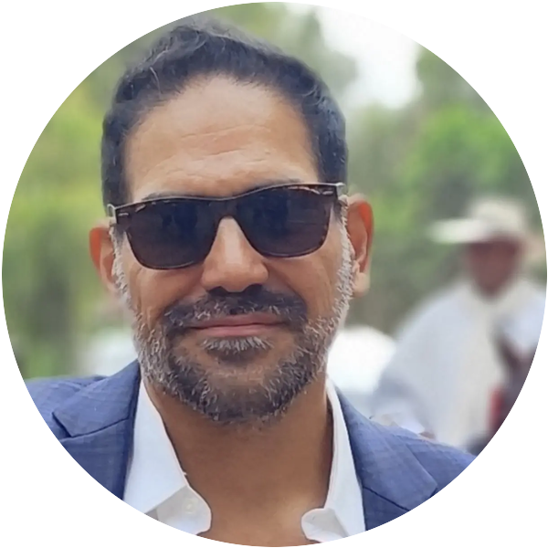

# Sobre el autor

**Marcelo Mario Berta Silva** leyó el Apocalipsis por primera vez en Washington, D. C., hacia 2001, y pasó las dos décadas siguientes volviendo a las preguntas que le dejó. Este libro es la investigación que esas preguntas terminaron por exigir.

Se describe como seguidor de YahuShúa HaMashíaj, un gentil injertado en el olivo del pacto de Israel.

Vive en Montevideo, Uruguay, donde desarrolla aplicaciones de software, escribe y canta. Lleva veinticuatro años casado con su esposa, Guisela, y tienen dos hijos, Fabiana y Elías. Habla inglés y español, y le encanta viajar, aprender cosas nuevas, programar y caminar por la Rambla de Montevideo.

Es también autor de *The Idea Vault* (2026), una guía práctica para construir un sistema personal que capture y conserve tus ideas, con herramientas abiertas de texto plano, para que nada que valga la pena se pierda. Está disponible en [kollabs.ai/tools/idea-vault](https://kollabs.ai/tools/idea-vault).

**Contacto:** [kuality.design](https://kuality.design) · [kollabs.ai](https://kollabs.ai) · [mars@kuality.design](mailto:mars@kuality.design)
